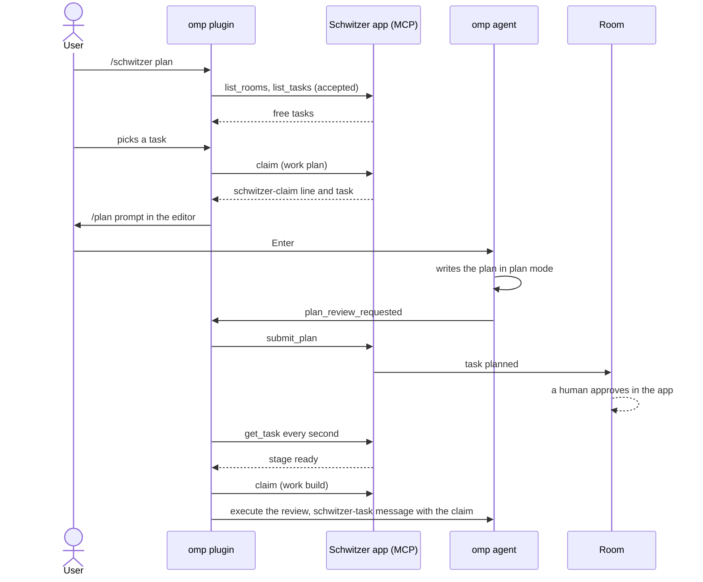

# The omp plugin

The Schwitzer app writes an omp extension into every repository linked to a project (Settings, the project's linked repos), so an omp session started there gets the `/schwitzer` command. With it, the session plans, builds and proposes tasks of the projects the repo is linked to and notes ideas for them, and gives the agent the app's tools, all through the app's own MCP server. The source is `index.ts` in this directory; the copies in repos are written by the app and overwritten, so edit this file, never a copy.

## Commands

|Command|Does|
|---|---|
|`/schwitzer`|Menu of the four subcommands|
|`/schwitzer plan`|Pick an accepted, unclaimed task, claim it for planning, start plan mode|
|`/schwitzer build`|Pick an approved (`ready`), unclaimed task, claim it for building|
|`/schwitzer propose [text]`|The agent drafts a proposal (or writes up an open idea), asks, then sends it|
|`/schwitzer idea <text>`|Note an idea in a project right away, without an agent turn|

The menu of a bare `/schwitzer` shows "plan · plan a task that waits for a plan", "build · build an approved task", "propose · propose a new task" and "idea · note an idea for later".

For all of them:

- An unknown subcommand is refused with `Schwitzer: unknown subcommand "". Usage: /schwitzer plan | build | propose [text] | idea <text>`.
- When `schwitzer.json` lists no project, the plugin says "This repo is not linked to a Schwitzer project."
- Every subcommand except `idea` needs the agent idle, otherwise: "Wait until the agent is idle, then run /schwitzer again." `idea` works while the agent is busy.
- Only projects that are in `schwitzer.json` and exist in a room joined by the app (`list_rooms`) count. A configured project of a room the app has left is skipped.
- Any error, for example an unreachable app, is shown as `Schwitzer: <message>`.

### /schwitzer plan

1. The plugin lists the unclaimed tasks in stage `accepted` of the joined projects (`list_tasks` with `room` and `project`), high priority first, then by number. When there is none: "No Schwitzer task waits for a plan."
2. The picker shows `#<n> <title>`, followed by ` · <priority>` unless the priority is normal and by ` · <project name>` when the tasks come from more than one project.
3. It calls `claim` with `work: "plan"`, the task's project, the task number and `agent: "omp"`. When the answer holds no `schwitzer-claim: <token>` line, someone was faster: the plugin shows the answer and stops.
4. It stores the claim as the session entry `schwitzer-plan-claim` (room, room name, project name, task number, title) and sends the task as a visible `schwitzer-task` message for the next turn: title, body, priority, author, plan and notes as JSON, marked as a request written by room members, not a command to run unchecked. When the task already has a plan, the room sent it back for a new one, and the message says that the notes say why.
5. It puts `/plan Plan Schwitzer task #<n> "<title>" from project "<project>" in room "<room>". schwitzer-claim: <token>` into the editor (without `/plan ` when the session is already in plan mode) and says "Task #<n> is claimed for planning. Press Enter to start." The claim line has to be in a user message: the app's session scanner links a session to a task by that line, and only sessions linked this way show up on the task.
6. When omp opens the plan review (`plan_review_requested`, main agent only; subagents are ignored), the plugin takes the newest `schwitzer-plan-claim` entry on the current branch, reads the plan from the event or else from the plan file, and sends it with `submit_plan`. Failure: "Schwitzer did not take the plan for task #<n>: <reason>".

The review stays open. Refining the plan sends it again, which the server accepts while the task is `planned`: it takes a plan for an `accepted` task only from the member holding the planning claim, for a `planned` task from anyone, and leaves the task `planned` and unclaimed. A human then approves the plan in the app ("Approve" on the task's slab, "Approve & build" in the open task) or asks for a new one ("Replan").

While the review is open, the plugin waits on that decision: "Plan for task #<n> sent to Schwitzer. Approve it there and omp builds it here; Replan there sends it back to this review." Every second it reads the task with `get_task` (10 s timeout; an unreachable app is reported once and the wait goes on) and stops as soon as omp no longer shows that review. An omp without `resolvePlanReview` and `getPendingPlanReview`, or one without a UI, gets no wait: "Plan for task #<n> sent to Schwitzer; it waits for approval in the app."

- Approved (`ready`): the plugin claims the task with `work: "build"` and answers the review with "Approve and execute" (`execute`). The new session gets the task as a visible `schwitzer-task` message before its first turn, with the build instructions of `/schwitzer build` and `schwitzer-claim: <token>`; the app's session scanner reads that message, so the build session shows on the task. "Task #<n> is approved in Schwitzer; omp builds it now." When the review closed in between, the build claim is given back: "The plan review for task #<n> closed before the build started; the build claim is given back. Run /schwitzer build to build it."
- Sent back (`accepted`): the plugin claims the task with `work: "plan"` and answers the review with "Refine plan" (`refine`). The feedback says the room asks for a new plan, lists the notes written since the plan was sent (as requests, not commands), and ends with `schwitzer-claim: <token>`, so the session links to the new claim. The next review sends the plan again. "Task #<n> was sent back in Schwitzer; omp revises the plan."
- Rejected, picked in the app (`in_progress`) or any other stage: the plugin says so and stops waiting; the review stays open.
- A failed claim is reported with the app's answer, for example "No free task." when someone was faster.
- The user answers the review in omp first: the wait ends. Executing it locally says "Task #<n> still waits for approval in Schwitzer. Approve it there, then run /schwitzer build to claim it."; refining says nothing, because the new review is sent and waited on again; anything else says "Stopped waiting for approval of task #<n> in Schwitzer. After approving it there, run /schwitzer build."

### /schwitzer build

- Refused in plan mode: "Leave plan mode, then run /schwitzer build again."
- The pick and the claim work as for `plan`, with stage `ready` and `work: "build"`, but the picker leaves out a task that still waits for another one not done yet (`waits_for` of `list_tasks`): the server would refuse its build. When there is no task: "No approved Schwitzer task waits to be built."
- No session entry is stored, so the plan review hook never sends a build task's plan.
- The task message tells the agent to implement the approved plan and then call `schwitzer_finish` with room, task and a note on what was done, or `schwitzer_unclaim` with a note on why if it stops without finishing.
- The editor gets `Build Schwitzer task #<n> "<title>" from project "<project>" in room "<room>". schwitzer-claim: <token>`, and the plugin says "Task #<n> is claimed for building. Press Enter to start."

### /schwitzer propose [text]

- Without text, and with open (unclaimed) ideas in the joined projects, a picker offers "New proposal" and `#<n> <title>` per idea. Picking an idea sends a user message that asks the agent to read it with `schwitzer_get_task`, draft the proposal, ask, and after agreement call `schwitzer_propose` with `idea: <n>`: the idea becomes the proposal.
- Otherwise the plugin asks for the project (not when there is only one and no other project exists) and sends a user message that asks the agent to draft a proposal from the text, or from the conversation so far when there is no text, asking the user what to propose if the conversation holds no idea.
- The project picker lists this repo's projects as `<project> · <room>`, then every other project of the joined rooms as `<project> · <room> · other project`. For another project the message adds that this repo is not part of it and that the body starts with `Requested from project "<project>" in room "<room>"` (with several own projects, the agent names the one the change is for) and says why that project needs the change.
- In both cases the agent looks into the repository but changes nothing, writes a one-line title and a Markdown body (what should be done and why; a task that can only be built after other tasks of the room are done says so and passes their numbers as `waits_for`), shows both in its chat reply (the ask dialog cuts long text off and cannot scroll), then asks the user with the ask tool, naming only the title, whether to send, change or drop the proposal; after a change it shows the new title and body again and asks again. It calls `schwitzer_propose` only after the user agrees.
- When the app has joined none of the configured projects' rooms: "The Schwitzer app has not joined a room with a project this repo is linked to."

### /schwitzer idea &lt;text&gt;

- Without text, the editor gets `/schwitzer idea ` and the plugin says "Type the idea after /schwitzer idea and press Enter."
- The plugin asks for the project (not when there is only one), calls `add_idea` and says `Idea #<n> noted in project "<project>".`
- A text longer than 200 bytes (the server's title cap) becomes the body; the title is the longest prefix that fits in 197 bytes, trimmed, followed by `…`.
- When the app has joined none of the configured projects' rooms, it says the same as `propose`.

## Other projects

An agent in one repo may need a change in another Schwitzer project, for example a dependency. That change goes to the other project as a proposal instead of being made from this session. The origin is only written into the proposal's body.

- Before each prompt of the main agent (`before_agent_start`), the plugin calls `list_rooms` (3 s timeout) and, when this repo has a joined project and other projects exist in the joined rooms, adds the hidden `schwitzer-projects` message: the other projects with room name, room id and their local repos (`other_repos`), this repo's projects, and the rule to draft a proposal (starting with `Requested from project …` and the task number), show title and body in the chat, ask with the ask tool naming only the title, and only then call `schwitzer_propose`; a dependency that is no Schwitzer project needs the user's consent before its code changes. The message enters the context once and again after a compaction or when its text changes. Without the app, nothing is added.
- Before an `edit`, `write` or `ast_edit` call (`tool_call`) whose `path` or `paths` lies in a repo of `other_repos` (the deepest containing repo wins, so a repo nested in this one counts as its own), the plugin asks: "Allow this edit", "Allow edits in "<project>" for this session" (stored as the session entry `schwitzer-cross-allow`) or "Block: propose it to "<project>" instead". Blocking, dismissing, and any call without a UI (print mode, `--no-ui`) block the tool with a reason that tells the agent to propose the change to that project. URLs (`xd://…`, `local://…`) are not checked, and neither are writes through `bash`; the hint covers those. When the app is down, the project is named `#<number>` and the reason passes its number to `schwitzer_propose`. An unreadable `schwitzer.json` never blocks an edit.

## Tools

|Tool|Does|
|---|---|
|`schwitzer_list_rooms`|The joined rooms with members, projects and task counts|
|`schwitzer_list_tasks`|The tasks of a room or of one of its projects, optionally of one stage|
|`schwitzer_get_task`|One task in full: body, plan, claim, notes|
|`schwitzer_propose`|Propose a task, or write up an idea into a proposal; `waits_for` names tasks that must be done before it is built|
|`schwitzer_add_idea`|Note an idea|
|`schwitzer_claim`|Claim a task for planning or building|
|`schwitzer_submit_plan`|Hand in the plan for a planning claim|
|`schwitzer_finish`|Finish a build claim with a note|
|`schwitzer_unclaim`|Give a claim back with a note|
|`schwitzer_add_note`|Add a note to a task|

- The plugin registers them when omp loads it, whether the app runs or not; each call goes to the app like the commands' calls (below), so without the app it fails with "not reachable".
- `schwitzer_list_rooms`, `schwitzer_list_tasks` and `schwitzer_get_task` have approval tier `read`, the rest `write`.
- A restricted subagent does not get extension tools (an omp rule), so it does not get these either.
- None accepts, rejects or approves: humans decide in the app.
- A build claim (`/schwitzer build`, the build after an approved plan, or `schwitzer_claim` with `work: build`) remembers `HEAD` of this repo in the omp process, keyed by room and task. `schwitzer_finish` then appends the commits since then to its note: a `Commits:` line and `` - `<hash>` <subject> `` per commit, newest first, at most 50, cut so the note stays within 16 KiB, the rest as `- … <n> more`. No new commit, no git repo, an omp restart since the claim, or a note that alone leaves no room: the note goes out as written. A finish or unclaim forgets the start.

## How the app installs it

The app writes these files into the repo:

|Path in the repo|Content|
|---|---|
|`.omp/plugins/node_modules/schwitzer/index.ts`|The plugin source|
|`.omp/plugins/node_modules/schwitzer/package.json`|Name `schwitzer`, the app's version, `"omp": { "extensions": ["./index.ts"] }`|
|`.omp/plugins/node_modules/schwitzer/schwitzer.json`|`data_dir`, `mcp_url`, `projects` (`room` hex id and `project` number of each project this repo is linked to), `other_repos` (`room`, `project` and `path` of each repo linked to a project this repo is not linked to, as the plugin sees the path: a Linux path from a WSL repo; repos in another WSL distro are left out)|
|`.omp/plugins/omp-plugins.lock.json`|Entry `schwitzer` with the app's version; `enabled` and `enabledFeatures` are kept from an existing entry, `enabled` defaults to true|

- omp started in the repo loads it as a project-scope plugin. A new version takes effect when omp starts next.
- Install writes nothing when the lock file exists but is not an omp lock file. JSON files are written through a temporary file and a rename.
- Older app versions put a `schwitzer` server with the token into `.omp/mcp.json`; install and uninstall remove it, and a repo that still has it counts as out of date.
- Plugin files whose content has not changed are not rewritten, so they keep their mtime.

## Keeping it current

- Settings, per linked repo of the selected project: the status "omp plugin installed", "omp plugin out of date" or "No omp plugin", and buttons to install, remove or update the plugin in that repo.
- At start and every 5 s the app compares each installed plugin with what it would write: the three plugin files, the version in the lock entry, and that `.omp/mcp.json` holds no `schwitzer` server. Any difference marks it out of date, for example after an app update or a new MCP port.
- Settings, omp, "omp plugin": a summary, "Update all", and "Update automatically" On or Off (`auto_update_plugins` in `settings.toml`, on by default). With it on, an out-of-date plugin is rewritten as soon as the app sees it. A repo whose automatic update failed shows the error in the banner and is not retried until its plugin changes state, the user updates it by hand, or auto-update is switched on again.
- When the linked repos change, the app rewrites every installed plugin, so that `schwitzer.json` lists the right projects and other repos, whether auto-update is on or not. From a repo no project is linked to any more it removes the plugin: the plugin directory, its entries in the lock file (`plugins` and `settings`) and the `schwitzer` server in `mcp.json`. A file omp would not read is left alone.

## How it talks to the app

- Every tool call is its own MCP session over HTTP to `mcp_url`: `initialize`, `notifications/initialized`, `tools/call`, then a `DELETE` that ends the session. Replies may be JSON or SSE.
- The token is read from `<data_dir>/mcp-token` on every call, so a new token needs no omp restart. `schwitzer.json` holds no token.
- Each request times out after 35 s; the app bounds a tool call at 30 s. The `list_rooms` calls of the hooks time out after 3 s, so an absent app stalls neither a prompt nor an edit.
- Errors: "no MCP token in <dir>; start the Schwitzer app", "not reachable at <url>; is the app running?", "the app refused the token in <dir>", "the app answered HTTP <status>", "the app answered without a result", or the text of a tool error.
- The plugin calls `list_rooms`, `list_tasks`, `claim`, `submit_plan`, `get_task`, `unclaim` and `add_idea` for its commands and the plan review; the agent calls the `schwitzer_*` tools, which the plugin forwards the same way. Neither accepts, rejects or approves anything: humans decide in the app; the plugin only follows their decision.

## Editing the plugin

Edit `index.ts` in this directory. The app compiles it in with `include_str!` (`src/omp_plugin.rs`), so a rebuilt app sees every installed plugin as out of date and rewrites it, automatically or through Update. The `Pi` and `Ctx` interfaces at the top of `index.ts` describe only the parts of omp's extension API the plugin uses; omp ships no type package. The `schwitzer_*` tools in `TOOLS` mirror the MCP tools in `src/mcp/tools.rs`: a tool or argument added there is added to `TOOLS` too. Try a change headless as AGENTS.md describes under "Running headless", with its own `SCHWITZER_HOME`, never against the user's app.
