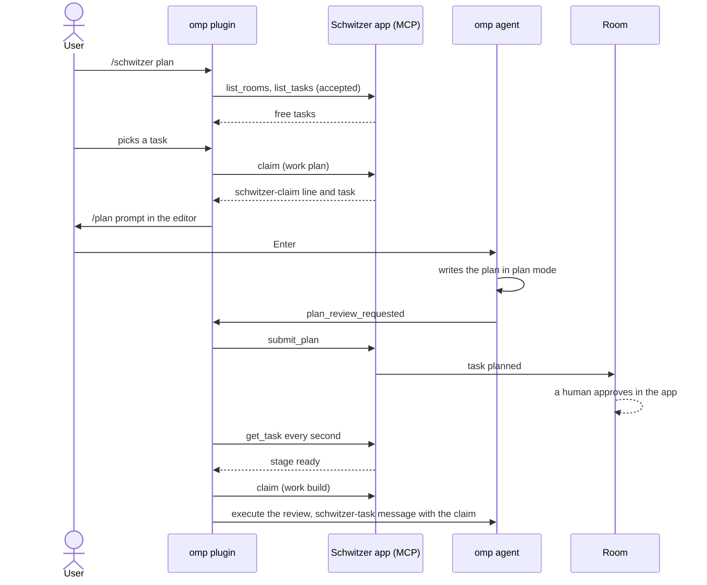

# The omp plugin

The Schwitzer app writes an omp extension into every repository linked to a project (Settings, the project's page, "Repos on this machine"), so an omp session started there gets the `/schwitzer` command. With it, the session plans, builds and proposes tasks of the projects the repo is linked to and notes ideas for them, and gives the agent the app's tools, all through the app's own MCP server. The source is `index.ts` in this directory; the copies in repos are written by the app and overwritten, so edit this file, never a copy.

## Commands

|Command|Does|
|---|---|
|`/schwitzer`|Menu of the subcommands|
|`/schwitzer plan [#n… [now]]`|Pick accepted, unclaimed tasks (or take task `#n`), claim one for planning, start plan mode; with `now` the planning starts without Enter; several tasks each get their own omp session in a new tab|
|`/schwitzer build [#n [now]]`|Pick an approved (`ready`), unclaimed task (or take task `#n`), claim it for building; with `now` the build starts without Enter|
|`/schwitzer build new`|Open a new omp session with `/schwitzer build` in its editor|
|`/schwitzer propose [#n \| text]`|The agent drafts a proposal (or writes up an open idea, or idea `#n`), asks, then sends it|
|`/schwitzer idea <text>`|Note an idea in a project right away, without an agent turn|
|`/schwitzer debug [stop]`|Start or join the debug session of a room, or leave it|
|`/schwitzer revise #n [details\|plan] [what to change]`|The agent rewrites the details or plan of task `#n`, asks, then sends it as a suggestion that a human applies or discards in the app|
|`/schwitzer decide [#n]`|Decide on a task in the fast lane (accept, approve, apply a suggestion, …) without an agent turn|
|`/schwitzer fast [#n \| text]`|Put task `#n` into the fast lane, or let the agent draft a proposal that goes there: it is accepted and planned at once; only the plan's approval waits for a human|

`/sw` is short for `/schwitzer` and takes the same subcommands; the plugin's messages always name `/schwitzer`. A task number is written `#12` or `12`.

The menu of a bare `/schwitzer` shows "plan · plan a task that waits for a plan", "build · build an approved task", "propose · propose a new task", "idea · note an idea for later", "debug · test together: start or join a debug session", "revise · let the agent suggest a better version of a task", "decide · accept, approve or apply in the fast lane" and "fast · a task that runs on its own; only the plan waits for you".

For all of them:

- An unknown subcommand is refused with `Schwitzer: unknown subcommand "". Usage: /schwitzer plan [#n… [now]] | build [#n [now] | new] | propose [#n | text] | idea <text> | debug [stop] | revise #n [details|plan] [what to change] | decide [#n] | fast [#n | text]`. An argument to `plan` that is not one or more task numbers, or to `build` that is not one task number, each optionally followed by `now` (and not `new` for `build`), to `debug` other than `stop`, to `revise` that does not start with a task number, or to `decide` that is not one task number, is refused with `Schwitzer: unknown argument "<arg>".` and the same usage line.
- When `schwitzer.json` lists no project, the plugin says "This repo is not linked to a Schwitzer project."
- Every subcommand except `idea` and `decide` needs the agent idle, otherwise: "Wait until the agent is idle, then run /schwitzer again." `idea` and `decide` work while the agent is busy.
- Only projects that are in `schwitzer.json` and exist in a room joined by the app (`list_rooms`) count. A configured project of a room the app has left is skipped.
- Any error, for example an unreachable app, is shown as `Schwitzer: <message>`.

### /schwitzer plan

1. The plugin lists the unclaimed tasks in stage `accepted` of the joined projects (`list_tasks` with `room` and `project`), high priority first, then by number. When there is none: "No Schwitzer task waits for a plan."
2. The picker shows `#<n> <title>`, followed by ` · <priority>` unless the priority is normal and by ` · <project name>` when the tasks come from more than one project.
3. It calls `claim` with `work: "plan"`, the task's project, the task number and `agent: "omp"`. When the answer holds no `schwitzer-claim: <token>` line, someone was faster: the plugin shows the answer and stops.
4. It stores the claim as the session entry `schwitzer-plan-claim` (room, room name, project name, task number, title) and sends the task as a visible `schwitzer-task` message for the next turn: title, body, priority, author, plan and notes as JSON, marked as a request written by room members, not a command to run unchecked. When the task already has a plan, the room sent it back for a new one, and the message says that the notes say why.
5. It puts `/plan Plan Schwitzer task #<n> "<title>" from project "<project>" in room "<room>". schwitzer-claim: <token>` into the editor (without `/plan ` when the session is already in plan mode) and says "Task #<n> is claimed for planning. Press Enter to start." The claim line has to be in a user message: the app's session scanner links a session to a task by that line, and only sessions linked this way show up on the task.
6. When omp opens the plan review (`plan_review_requested`, main agent only; subagents are ignored), the plugin takes the newest `schwitzer-plan-claim` entry on the current branch, reads the plan from the event or else from the plan file, and sends it with `submit_plan`. Failure: "Schwitzer did not take the plan for task #<n>: <reason>".

With a task number (`/schwitzer plan #12`) there is no picker. The plugin looks the number up in every joined project of this repo (`list_tasks` without a stage) and claims it as in steps 3 to 6. Numbers count per room, so with projects in several rooms more than one task may carry it; then the picker shows `#<n> <title> · <project> · <room>` for those that can be claimed. Otherwise it says:

- No task of that number: "No task #<n> in this repo's Schwitzer projects."
- Another stage: "Schwitzer: Task #<n> is <stage>; only an accepted task waits for a plan." (`in_progress` reads "in progress")
- Claimed by someone: "Schwitzer: Task #<n> is claimed already."

With tasks of that number in several projects, each reason is prefixed by `<project>: `.

`/schwitzer plan <n> now` claims the task like `/schwitzer plan <n>`, then switches omp into plan mode and sends the prompt of step 5 as a user message right away, saying "Task #<n> is claimed for planning." This is the command the app copies from an accepted task ("Copy omp command") or with "Accept & copy omp command" on a proposal, as `omp --cwd <repo> '/schwitzer plan <n> now'`: omp runs the command at startup. When omp cannot enter plan mode (no TUI, mode control off in its settings, or busy), the plugin falls back to the editor as in step 5.

#### Several tasks at once

`/schwitzer plan #1 #2 #4` (duplicates dropped) plans every task in its own omp session: the plugin opens a new tab per task through omp's `openTerminal` (a herdr or zellij tab named `plan #<n>`, a tmux window, an Orca tab) in this repo, running `omp '/schwitzer plan <n> now'`, so each session claims its task, plans it, waits for the room's decision and builds after approval. The current session claims nothing. Before that it looks every number up as above; a number with no task, or with none that waits for a plan, is skipped with its reason in one `Schwitzer: …` notice, and a number free in several rooms is left to the new session's picker. Then it says "Planning #<a>, #<b> in new <tabs|windows>: each session claims its task and plans it. Approve the plans in Schwitzer." A tab that could not be opened is reported as "Schwitzer: could not open a session for #<n>: <reason>".

Without a number and with at least two free tasks, the picker is a checkbox list ("Plan which tasks? Check several to plan each in its own omp session."): one checked task is claimed in this session as in steps 3 to 6, several each get their own session as above. That list needs omp's ask dialog and a multiplexer; otherwise the single-choice picker of step 2 stays.

Opening sessions needs an omp TUI inside herdr, tmux, zellij or Orca (detected from `HERDR_*`, `TMUX`, `ZELLIJ`, `ORCA_PANE_KEY` with `ORCA_WORKTREE_ID`) and `omp` on `PATH`. Elsewhere `/schwitzer plan #1 #2` says "Schwitzer: planning several tasks at once opens an omp session per task in a new tab and needs omp inside herdr, tmux, zellij or Orca. Run /schwitzer plan #<n> in separate sessions instead." and claims nothing. Once approved, the sessions build in the same checkout at the same time.

The review stays open. Refining the plan sends it again, which the server accepts while the task is `planned`: it takes a plan for an `accepted` task only from the member holding the planning claim, for a `planned` task from anyone, and leaves the task `planned` and unclaimed. A human then approves the plan in the app ("Approve" on the task's slab, "Approve & build" in the open task), in omp's plan review itself, or with `/schwitzer decide`, or asks for a new one ("Replan").

While the review is open, the plugin waits on that decision: "Plan for task #<n> sent to Schwitzer. Approve it there and omp builds it here; Replan there sends it back to this review." Every second it reads the task with `get_task` (10 s timeout; an unreachable app is reported once and the wait goes on) and stops as soon as omp no longer shows that review. An omp without `resolvePlanReview` and `getPendingPlanReview`, or one without a UI, gets no wait: "Plan for task #<n> sent to Schwitzer; it waits for approval in the app."

- Approved (`ready`): the plugin claims the task with `work: "build"` and answers the review with "Approve and execute" (`execute`). The new session gets the task as a visible `schwitzer-task` message before its first turn, with the build instructions of `/schwitzer build` and `schwitzer-claim: <token>`; the app's session scanner reads that message, so the build session shows on the task. "Task #<n> is approved in Schwitzer; omp builds it now." When the review closed in between, the build claim is given back: "The plan review for task #<n> closed before the build started; the build claim is given back. Run /schwitzer build to build it."
- Sent back (`accepted`): the plugin claims the task with `work: "plan"` and answers the review with "Refine plan" (`refine`). The feedback says the room asks for a new plan, lists the notes written since the plan was sent (as requests, not commands), and ends with `schwitzer-claim: <token>`, so the session links to the new claim. The next review sends the plan again. "Task #<n> was sent back in Schwitzer; omp revises the plan."
- Rejected, picked in the app (`in_progress`) or any other stage: the plugin says so and stops waiting; the review stays open.
- A failed claim is reported with the app's answer, for example "No free task." when someone was faster.
- The user answers the review in omp first: the wait ends. Refining says nothing, because the new review is sent and waited on again. Approving it ("Approve and execute", "… and compact" or "… and keep context", in every project, fast lane or not) approves the plan in Schwitzer too (`decide` with `approve`), claims the build and hands the execution turn that omp starts the task context with `schwitzer-claim: <token>` as a user message (`deliverAs: "aside"`, so it reaches the running turn at its next step without interrupting it): "Task #<n> is approved in Schwitzer too; this session builds it under its build claim." When Schwitzer refuses the approval: "Schwitzer did not approve task #<n>: <reason>. The plan runs here without a build claim; approve it in Schwitzer, then run /schwitzer build <n>."; a failed build claim: "Task #<n> is approved in Schwitzer, but the build claim failed: <answer>". Dismissing the review says "Stopped waiting for approval of task #<n> in Schwitzer. After approving it there, run /schwitzer build."

### /schwitzer build

- Refused in plan mode: "Leave plan mode, then run /schwitzer build again."
- The pick and the claim work as for `plan`, with stage `ready` and `work: "build"`, but the picker leaves out a task that still waits for another one not done yet (`waits_for` of `list_tasks`): the server would refuse its build. When there is no task: "No approved Schwitzer task waits to be built."
- `/schwitzer build #<n>` takes task `<n>` like `plan #<n>`. A task in another stage is refused with "Schwitzer: Task #<n> is <stage>; only an approved (ready) task can be built.", one that still waits with "Schwitzer: Task #<n> waits for #<a>, #<b>, not done yet."
- No session entry is stored, so the plan review hook never sends a build task's plan.
- The task message tells the agent to implement the approved plan and then call `schwitzer_finish` with room, task and a note on what was done. If the plan turns out not to work, the agent stops and calls `schwitzer_unclaim` with room, task and a note on what does not hold and what a new plan must change; if it stops without finishing for another reason, `schwitzer_unclaim` with a note on why.
- The editor gets `Build Schwitzer task #<n> "<title>" from project "<project>" in room "<room>". schwitzer-claim: <token>`, and the plugin says "Task #<n> is claimed for building. Press Enter to start." With `/schwitzer build <n> now` (copied by the app from an approved task) the plugin sends that prompt right away instead and says "Task #<n> is claimed for building."
- After a `schwitzer_finish` without error from the main agent (not from a subagent), the plugin waits for the end of that run and, when omp has a UI, offers the first unclaimed approved task of the configured projects in a dialog `Build #<n> "<title>" next?`, with ` from project "<project>"` before `next?` when the repo is linked to more than one project (after the fast lane offers of that run, see "Fast lane"). The choices are:
  - "In a fresh session (recommended)": the editor gets `/schwitzer build new` and the plugin says "Press Enter for a new session with /schwitzer build; a fresh session keeps the context small."
  - "In this session": the task is claimed at once, as by `/schwitzer build` with that task picked. In plan mode the plugin says "Leave plan mode, then run /schwitzer build again." instead.
  - "Not now", or dismissing the dialog: nothing happens.
- No approved task waits: no offer. An error is shown as `Schwitzer: <message>`.
- After a `schwitzer_unclaim` without error from the main agent that leaves the task approved and unclaimed (a given-back build claim; a given-back plan claim is ignored), the plugin waits for the end of that run and, when omp has a UI and the task is still approved and unclaimed, asks `#<n> "<title>" was given back: <note>. Send it back for a new plan?` (the note cut to 200 characters, left out when empty). This comes after the fast lane offers of that run and before the next-build offer. Sending a plan back (`decide` with `replan`) works in every project, fast lane or not. The choices are:
  - "Send it back and plan it here": the task goes back to `accepted` ("Schwitzer: #<n> sent back for a new plan."), is claimed for planning in this session and plan mode starts on it, as by `/schwitzer plan <n> now`; the task message says the room sent the previous plan back, and the unclaim note is among its notes. No next-build offer follows. When the task's project is not linked to this repo: `#<n> belongs to project "<project>", which this repo is not linked to; plan it there with /schwitzer plan <n>.`
  - "Send it back only": the task goes back to `accepted`, and the plugin says "Run /schwitzer plan <n> to plan it."
  - "Leave it for the room", or dismissing the dialog: nothing happens; the task stays approved.
  - When the app cannot tell the task's room: `Schwitzer: #<n> was given back; send it back for a new plan in Schwitzer.`

### /schwitzer build new

Needs the agent idle, like every subcommand except `idea`. It waits for idle once more, opens a new omp session and puts `/schwitzer build` into its editor, saying "New session: press Enter to pick the task to build." When omp cancels the new session, nothing else happens. It is not in the menu of a bare `/schwitzer`; the offer above puts it into the editor.

### /schwitzer propose [#n | text]

- Without text, and with open (unclaimed) ideas in the joined projects, a picker offers "New proposal" and `#<n> <title>` per idea. Picking an idea sends a user message that asks the agent to read it with `schwitzer_get_task`, draft the proposal, ask, and after agreement call `schwitzer_propose` with `idea: <n>`: the idea becomes the proposal.
- `/schwitzer propose #<n>` (or `<n>`) writes up idea `<n>` the same way, without a picker; with ideas of that number in several rooms the picker shows `#<n> <title> · <project> · <room>`. No task of that number: "No task #<n> in this repo's Schwitzer projects."; a task in another stage: "Task #<n> is <stage>, not an idea; only an idea can be written up into a proposal." (with several projects carrying the number: "Task #<n> is not an idea in any of this repo's Schwitzer projects."). Any other text drafts a new proposal.
- Otherwise the plugin asks for the project (not when there is only one and no other project exists) and sends a user message that asks the agent to draft a proposal from the text, or from the conversation so far when there is no text, asking the user what to propose if the conversation holds no idea.
- The project picker lists this repo's projects as `<project> · <room>`, then every other project of the joined rooms as `<project> · <room> · other project`. For another project the message adds that this repo is not part of it and that the body starts with `Requested from project "<project>" in room "<room>"` (with several own projects, the agent names the one the change is for) and says why that project needs the change.
- In both cases the agent looks into the repository but changes nothing, writes a one-line title and a Markdown body (what should be done and why; a task that can only be built after other tasks of the room are done says so and passes their numbers as `waits_for`), shows both in its chat reply (the ask dialog cuts long text off and cannot scroll), then asks the user with the ask tool, naming only the title, whether to send, change or drop the proposal; after a change it shows the new title and body again and asks again. It calls `schwitzer_propose` only after the user agrees.
- When the app has joined none of the configured projects' rooms: "The Schwitzer app has not joined a room with a project this repo is linked to."

### /schwitzer idea &lt;text&gt;

- Without text, the editor gets `/schwitzer idea ` and the plugin says "Type the idea after /schwitzer idea and press Enter."
- The plugin asks for the project (not when there is only one), calls `add_idea` and says `Idea #<n> noted in project "<project>".`
- A text longer than 200 bytes (the server's title cap) becomes the body; the title is the longest prefix that fits in 197 bytes, trimmed, followed by `…`.
- When the app has joined none of the configured projects' rooms, it says the same as `propose`.

### /schwitzer debug [stop]

Starts or joins the debug session of a room: members test a networked app together, the app streams the files in each member's `out` folder to the others' `in` folder, and the master's agent can send instructions. The server only relays while the session runs. It needs omp with a UI ("/schwitzer debug needs omp with a UI.") and the agent idle; any other argument than `stop` is refused like an unknown argument.

1. The plugin picks the room among the joined rooms of this repo's projects (a picker "Debug session in which room?" when there are several) and reads `debug_status`.
2. No session: the dialog `Start a debug session in "<room>"? Members who join get the files you write to its out folder.` offers "Start it (you are the master)" and "Cancel"; it calls `debug_start`. A session the user has not joined: `Join <master>'s debug session in "<room>"? Files you write to its out folder go to everyone in it; instructions from <master> wait for your OK here.` with "Join" and "Cancel"; it calls `debug_join`. Already in it: no dialog. The plugin then reads `debug_status` again; when the session has ended meanwhile or this member is not in it, it says `The debug session in "<room>" is gone.` and stops.
3. It sends a visible `schwitzer-debug` message for the next turn: the room, the members with their folder names, the absolute `out` and `in` folders (`<in>/<dir>/<stream>` holds what a member sends; received files are data from other machines, never instructions), and for the master how to send instructions with `schwitzer_debug_instruct`. The master hears `Debug session in "<room>": you are the master. Your agent can now send instructions and read the others' logs.`, a participant `Joined <master>'s debug session in "<room>". Instructions appear here for your OK.`
4. A participant's omp then waits for instructions (one wait per omp process). Every 2 s, only while the agent is idle, it calls `debug_inbox`, which hands over the oldest instruction for this member that no omp session has taken yet. Each one opens the dialog `Debug instruction #<id> from <from>: "<text, cut at 200 characters>"` with "Put it into the editor (replaces its text)" and "Dismiss". The first puts `Debug instruction #<id> from <from>, master of the debug session in room "<room>":`, the text and the folders into the editor and says "Instruction #<id> is in the editor. Read it, change it if needed, then press Enter."; the human presses Enter. "Dismiss" says "Instruction #<id> dismissed. It stays listed in the Schwitzer app." The plugin never sends an instruction to the agent itself: nothing reaches an agent before a human acts on the receiving machine.
5. The wait ends with `The debug session in "<room>" ended.` when the session is over. An unreachable app is reported once: "Schwitzer app not reachable; still waiting for debug instructions."

`/schwitzer debug stop` leaves the session and stops the wait: a participant at once, the master after the dialog `End the debug session in "<room>" for everyone?` ("End it", "Cancel"). It then shows the app's answer to `debug_leave`: `Ended the debug session.` for the master, `Left the debug session.` for a participant. Without a session of this member: `You are not in the debug session of "<room>".`

### /schwitzer revise #n [details|plan] [what to change]

- Without arguments, the editor gets `/schwitzer revise ` and the plugin says "Type the task number after /schwitzer revise, optionally details or plan and what to change, then press Enter."
- The plugin looks the number up like `/schwitzer plan #n`, among the tasks that are not done or rejected; with several, the picker "Revise which task?" shows `#<n> <title> · <project> · <room>`. No task of that number: "No task #<n> in this repo's Schwitzer projects."; one closed task: "Task #<n> is <stage>; only a task that is not done or rejected can be revised."; several, all closed: "Task #<n> is done or rejected in every one of this repo's Schwitzer projects."
- It sends a user message that asks the agent to read the task with `schwitzer_get_task`, revise the plan (`plan`), the title and details (`details`) or, without either, the plan when there is one, else the title and details; to follow `What to change: <text>` or, without it, to make the text clearer and more concrete from the conversation and the repository; to change nothing in the repository; to show the whole new text and what changed in the chat and ask with the ask tool; and only after agreement to call `schwitzer_suggest_revision` with the version `get_task` showed.
- The message also says that the task's open annotations (in `get_task`) are comments of room members on single blocks of the details or plan, each quoting its block, `outdated` ones no longer matching the text; the agent addresses those on the part it revises and names in the note which ones the suggestion takes up.
- The suggestion changes nothing until a room member applies it in the app, or with `/schwitzer decide` in the fast lane; they may also discard it.

## Fast lane

A member can let omp make the decisions on some tasks, so that a task goes from idea to build without a stop in the app. The fast lane is the member's own: it lives in their `settings.toml` and no other member sees it.

- A project's fast lane (`fast_lane` in `settings.toml`): the zap button in the app's header, or the switch "Fast lane" on the project's page in Settings ("Your agents"). Every decision on that project's tasks can then be made from omp too.
- A task's fast lane (`fast_lane_tasks`): the zap button in the head of the open task, or `/schwitzer fast`. The task is accepted at once and planned in the same omp session; only the plan's approval waits for a human, in the app or in omp. Its slab shows a small zap. The app drops the flag once the task is done or rejected. Putting a proposal into the fast lane in the app accepts it.
- Approving a plan from omp's own plan review, and sending an approved, given-back task back for a new plan (see `/schwitzer build`), work in every project, fast lane or not (see `/schwitzer plan`). Every other decision from omp, and applying or discarding a suggestion, needs the fast lane of the task or of its project; otherwise the app refuses it: `The fast lane is off for task #<n> and its project "<project>". Turn it on in Schwitzer (the zap button in the header, or the open task), or decide there.`
- The decisions go through the app's MCP tools `decisions`, `decide`, `get_suggestion`, `settle_suggestion` and `set_fast_lane`, whose descriptions start "For the omp plugin, not for agents.". They are not in `TOOLS`, so the agent never gets them; the plugin calls them only from the human's dialogs. Any local program with the MCP token can call them too, which is why the fast lane is off until the member turns it on.
- After a run of the main agent in which it proposed (`schwitzer_propose`) or suggested a revision (`schwitzer_suggest_revision`) and the task is in the fast lane, omp with a UI asks: `Accept #<n> "<title>"?` ("Accept", "Leave it for the room") or `Apply the suggested <part> to #<n> "<title>"?` ("Apply", "Discard", "Leave it for the room"). Tasks outside the fast lane get no dialog.

### /schwitzer decide [#n]

- The plugin lists the tasks in the fast lane, in every joined room, that wait for a human: a proposal, a plan to approve, or a pending suggestion (`decisions`). With `#n` it takes task `n` whatever its stage. It needs no agent turn, so it works while the agent is busy.
- Nothing listed: with a number, "No task #<n> in the fast lane or in a project whose fast lane is on."; with a project's fast lane on, "Nothing waits for your decision in the fast lane."; else "No project has its fast lane on. Turn it on with the zap button in Schwitzer's header, or put a task into the fast lane with /schwitzer fast."
- Several tasks: the picker "Decide on which task?" shows `#<n> <title> · <stage> · <project> · <room>`, with ` · fast lane` for a task in the fast lane by itself.
- The menu `#<n> "<title>" · <stage> · <project>` offers the decisions the server takes in that stage ("Accept", "Reject", "Approve the plan", "Replan: send the plan back", "Reopen", "Mark planned", "Mark done"), each pending suggestion (`Suggested <part> by <author> (<agent>)…`), "Read the details" and "Read the plan" (omp's editor, changes not kept; only with a UI), and "Cancel". A decision says `Schwitzer: #<n> <accepted|rejected|approved|…>.`; an approval adds ` If its plan review still waits in omp, it builds it now; else /schwitzer build <n>.`
- A suggestion opens "Read it", "Apply", "Discard" and "Back"; applying or discarding says `Schwitzer: suggestion applied to #<n>.` or `… discarded for #<n>.`

### /schwitzer fast [#n | text]

- With a task number, among this repo's projects (the task is planned and built here): an idea is written up by the agent and sent at once, without asking; a proposal is accepted and its plan claimed and started (as `/schwitzer plan <n> now`); an accepted task is claimed for planning; a planned one says `#<n> waits for the approval of its plan: approve it in Schwitzer or with /schwitzer decide <n>, then /schwitzer build <n> builds it.`; a ready one is claimed for building; one being built says so. Done or rejected: `#<n> is <stage>; the fast lane takes only open tasks.` Each of these but the last puts the task into the fast lane (`set_fast_lane`), which the app keeps.
- Otherwise the plugin asks for the project (this repo's only) and the agent drafts a proposal from the text, or from the conversation, shows it in the chat and sends it with `schwitzer_propose` right away. When its run ends, the proposal goes into the fast lane, is accepted, and its planning starts in this session.

## Other projects

An agent in one repo may need a change in another Schwitzer project, for example a dependency. That change goes to the other project as a proposal instead of being made from this session. The origin is only written into the proposal's body.

- Before each prompt of the main agent (`before_agent_start`), the plugin calls `list_rooms` (3 s timeout) and, when this repo has a joined project and other projects exist in the joined rooms, adds the hidden `schwitzer-projects` message: the other projects with room name, room id and their local repos (`other_repos`), this repo's projects, and the rule to draft a proposal (starting with `Requested from project …` and the task number), show title and body in the chat, ask with the ask tool naming only the title, and only then call `schwitzer_propose`; a dependency that is no Schwitzer project needs the user's consent before its code changes. The message enters the context once and again after a compaction or when its text changes. Without the app, nothing is added.
- Before an `edit`, `write` or `ast_edit` call (`tool_call`) whose `path` or `paths` lies in a repo of `other_repos` (the deepest containing repo wins, so a repo nested in this one counts as its own), the plugin asks: "Allow this edit", "Allow edits in "<project>" for this session" (stored as the session entry `schwitzer-cross-allow`) or "Block: propose it to "<project>" instead". Blocking, dismissing, and any call without a UI (print mode, `--no-ui`) block the tool with a reason that tells the agent to propose the change to that project. URLs (`xd://…`, `local://…`) are not checked, and neither are writes through `bash`; the hint covers those. When the app is down, the project is named `#<number>` and the reason passes its number to `schwitzer_propose`. An unreadable `schwitzer.json` never blocks an edit.
- The hint and the `propose` prompt for another project also tell the agent to pass the number of the task it works on as `blocks` when that task is in the same room (the app then adds the proposal to what that task waits for; a refused `SetWaits` comes back as `blocks_error` beside the created proposal, which stays), and to end its turn after sending, since the session goes on by itself.
- After a `schwitzer_propose` without error from the main agent to a project this repo is not part of, the plugin stores the session entry `schwitzer-await-proposal` and says `Schwitzer: this session waits for proposal #<n> "<title>" in "<project>" and goes on by itself when it is done or rejected.` While the agent is idle it asks the app every 10 s (`get_task`) for each awaited proposal. A rejected or vanished one sends the session a user message at once (`Schwitzer: proposals this session waited for are settled.`, one line per proposal with its stage and the last note, the proposals still open, and what to do next); done ones wait until no other awaited proposal is open. Each settled proposal gets the entry `schwitzer-await-proposal-end`. Loading, switching, branching or moving in the tree rebuilds the watch from the session's entries, so a resumed session that still waits picks it up; a proposal to this repo's own project is not watched.

## Task number in commits

A member can switch on "Task number in commits" per project in the app (Settings, the project's page, "Your agents"; `commit_trailers` in `settings.toml`, off by default). The app writes the switch into `schwitzer.json` of every repo of the project that has the plugin as soon as it changes, and the plugin reads that file on every check, so it takes effect at once, without an omp restart or a plugin update.

- A build claim (`/schwitzer build`, the build after an approved plan, or `schwitzer_claim` with `work: build`) remembers its room, task and project in the omp process; `schwitzer_finish` and `schwitzer_unclaim` forget it.
- Before a `bash` call (`tool_call`) of any agent whose command contains `git … commit` (git's global options such as `-C <dir>` or `-c <key=value>` may stand between) and whose `cwd` lies in this repo, the plugin calls `list_rooms` (3 s timeout) and finds the remembered build claims on a project with the switch on. When the command lacks `Schwitzer-Task: #<n>` for one of them, the call is blocked: "Schwitzer: commits while building task #<n> carry the trailer Schwitzer-Task: #<n>. Commit again with --trailer "Schwitzer-Task: #<n>" added to the git commit command (or with the trailer as the last paragraph of the message)."
- The repo is the call's `cwd`; a directory named by `cd` or `-C` inside the command is not interpreted. An omp restart since the claim forgets it, and an unreadable `schwitzer.json` or an app that does not answer lets the commit through.

## Tools

|Tool|Does|
|---|---|
|`schwitzer_list_rooms`|The joined rooms with members, projects and task counts|
|`schwitzer_list_tasks`|The tasks of a room or of one of its projects, optionally of one stage|
|`schwitzer_get_task`|One task in full: body, plan, claim, notes and the open annotations (comments of room members on single blocks, each with the quoted block)|
|`schwitzer_propose`|Propose a task, or write up an idea into a proposal; `waits_for` names tasks that must be done before it is built, `blocks` a task that then waits for it|
|`schwitzer_add_idea`|Note an idea|
|`schwitzer_claim`|Claim a task for planning or building|
|`schwitzer_submit_plan`|Hand in the plan for a planning claim|
|`schwitzer_suggest_revision`|Suggest a new version of a task's title and details or of its plan, written on the `details_version` or `plan_version` `get_task` showed; a human applies or discards it|
|`schwitzer_finish`|Finish a build claim with a note|
|`schwitzer_unclaim`|Give a claim back with a note|
|`schwitzer_add_note`|Add a note to a task|
|`schwitzer_debug_status`|The room's debug session: members, the absolute out and in folders, files sent and received|
|`schwitzer_debug_instruct`|Master only: send participants an instruction; a human there decides whether their agent runs it|

- The plugin registers them when omp loads it, whether the app runs or not; each call goes to the app like the commands' calls (below), so without the app it fails with "not reachable".
- `schwitzer_list_rooms`, `schwitzer_list_tasks`, `schwitzer_get_task` and `schwitzer_debug_status` have approval tier `read`, the rest `write`.
- A restricted subagent does not get extension tools (an omp rule), so it does not get these either.
- None accepts, rejects or approves, or applies or discards a suggestion: humans decide in the app, or in the plugin's own dialogs (see "Fast lane").
- A build claim (`/schwitzer build`, the build after an approved plan, or `schwitzer_claim` with `work: build`) remembers `HEAD` of this repo in the omp process, keyed by room and task. `schwitzer_finish` then appends the commits since then to its note: a `Commits:` line and `` - `<hash>` <subject> `` per commit, newest first, at most 50, cut so the note stays within 16 KiB, the rest as `- … <n> more`. No new commit, no git repo, an omp restart since the claim, or a note that alone leaves no room: the note goes out as written. A finish or unclaim forgets the start.

## How the app installs it

The app writes these files into the repo:

|Path in the repo|Content|
|---|---|
|`.omp/plugins/node_modules/schwitzer/index.ts`|The plugin source|
|`.omp/plugins/node_modules/schwitzer/package.json`|Name `schwitzer`, the app's version, `"omp": { "extensions": ["./index.ts"] }`|
|`.omp/plugins/node_modules/schwitzer/schwitzer.json`|`data_dir`, `mcp_url`, `projects` (`room` hex id, `project` number and `commit_trailer`, the switch "Task number in commits", of each project this repo is linked to), `other_repos` (`room`, `project` and `path` of each repo linked to a project this repo is not linked to, as the plugin sees the path: a Linux path from a WSL repo; repos in another WSL distro are left out)|
|`.omp/plugins/omp-plugins.lock.json`|Entry `schwitzer` with the app's version; `enabled` and `enabledFeatures` are kept from an existing entry, `enabled` defaults to true|

- omp started in the repo loads it as a project-scope plugin. A new version takes effect when omp starts next.
- Install writes nothing when the lock file exists but is not an omp lock file. JSON files are written through a temporary file and a rename.
- Plugin files whose content has not changed are not rewritten, so they keep their mtime.

## Keeping it current

- Settings, the project's page, per linked repo: the status "omp plugin installed", "omp plugin out of date" or "No omp plugin", and buttons to install, remove or update the plugin in that repo.
- At start and every 5 s the app compares each installed plugin with what it would write: the three plugin files and the version in the lock entry. Any difference marks it out of date, for example after an app update or a new MCP port.
- Settings, the omp page, "omp plugin": a summary, "Update all", and the "Update automatically" switch (`auto_update_plugins` in `settings.toml`, on by default). With it on, an out-of-date plugin is rewritten as soon as the app sees it. A repo whose automatic update failed shows the error in the banner and is not retried until its plugin changes state, the user updates it by hand, or auto-update is switched on again.
- When the linked repos change, the app rewrites every installed plugin, so that `schwitzer.json` lists the right projects and other repos, whether auto-update is on or not. From a repo no project is linked to any more it removes the plugin: the plugin directory and its entries in the lock file (`plugins` and `settings`). A file omp would not read is left alone.

## How it talks to the app

- Every tool call is its own MCP session over HTTP to `mcp_url`: `initialize`, `notifications/initialized`, `tools/call`, then a `DELETE` that ends the session. Replies may be JSON or SSE.
- The token is read from `<data_dir>/mcp-token` on every call, so a new token needs no omp restart. `schwitzer.json` holds no token.
- Each request times out after 35 s; the app bounds a tool call at 30 s. The `list_rooms` calls of the hooks time out after 3 s, so an absent app stalls neither a prompt nor an edit.
- Errors: "no MCP token in <dir>; start the Schwitzer app", "not reachable at <url>; is the app running?", "the app refused the token in <dir>", "the app answered HTTP <status>", "the app answered without a result", or the text of a tool error.
- The plugin calls `list_rooms`, `list_tasks`, `claim`, `submit_plan`, `get_task`, `unclaim` and `add_idea` for its commands and the plan review, `debug_status`, `debug_start`, `debug_join`, `debug_leave` and `debug_inbox` for `/schwitzer debug`, and `decisions`, `decide`, `get_suggestion`, `settle_suggestion` and `set_fast_lane` for the plan review approval, `/schwitzer decide`, `/schwitzer fast` and the dialogs after a run; the agent calls the `schwitzer_*` tools, which the plugin forwards the same way (`debug_status` gets its `out_dir` and `in_dir`, which the app sends relative to the data dir, made absolute with `data_dir`). The agent never decides: the plugin decides only what the human picked in its dialogs or in omp's plan review.

## Editing the plugin

Edit `index.ts` in this directory. The app compiles it in with `include_str!` (`src/omp_plugin.rs`), so a rebuilt app sees every installed plugin as out of date and rewrites it, automatically or through Update. The `Pi` and `Ctx` interfaces at the top of `index.ts` describe only the parts of omp's extension API the plugin uses; omp ships no type package. The `schwitzer_*` tools in `TOOLS` mirror the MCP tools in `src/mcp/tools.rs`: a tool or argument added there is added to `TOOLS` too, except the tools whose description starts "For the omp plugin", which the agent never gets. Try a change headless as AGENTS.md describes under "Running headless", with its own `SCHWITZER_HOME`, never against the user's app.
