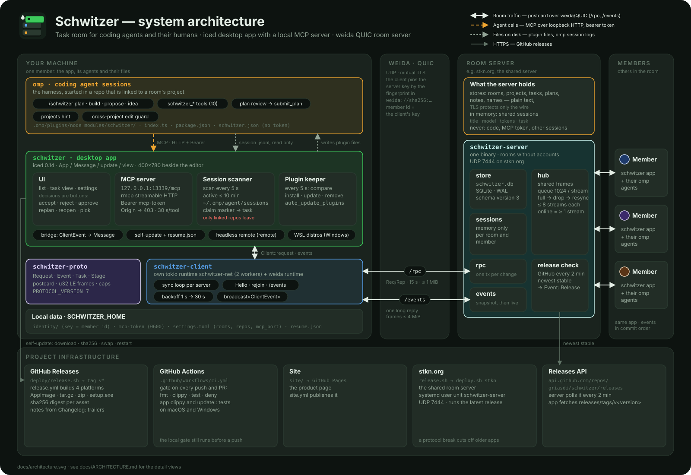
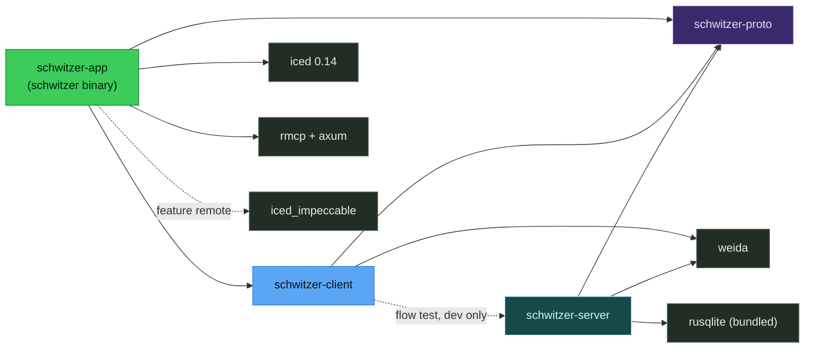
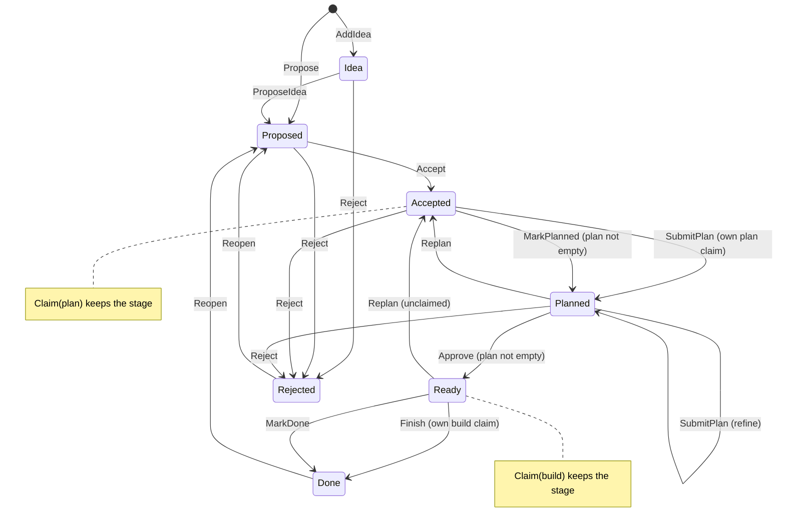
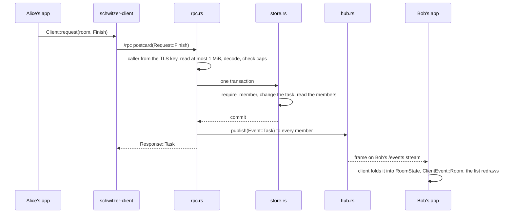
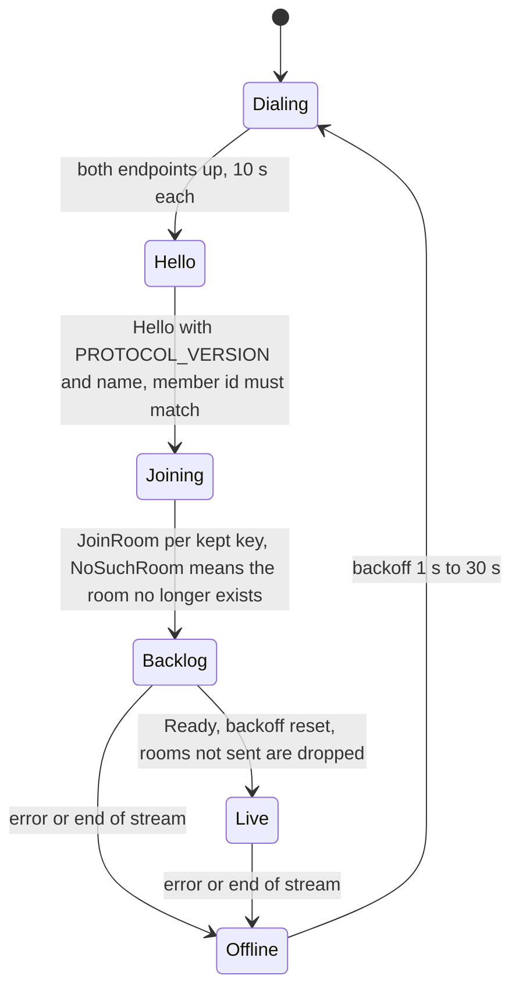
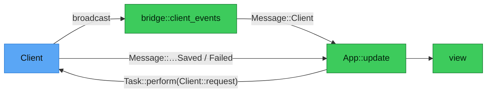
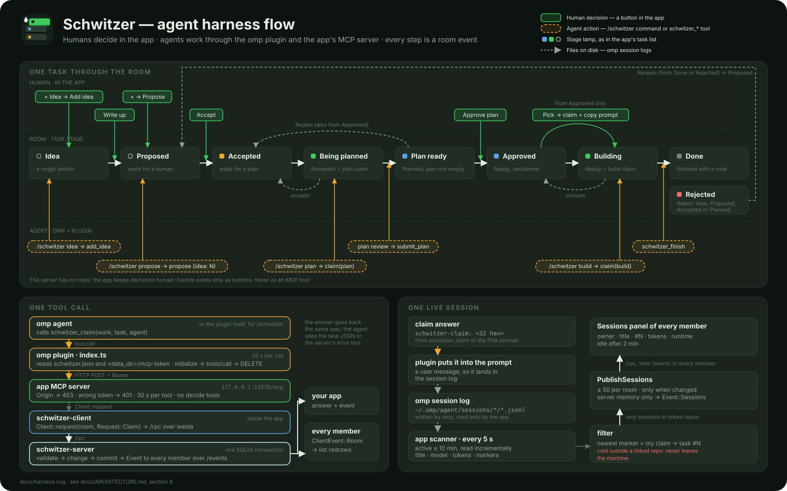
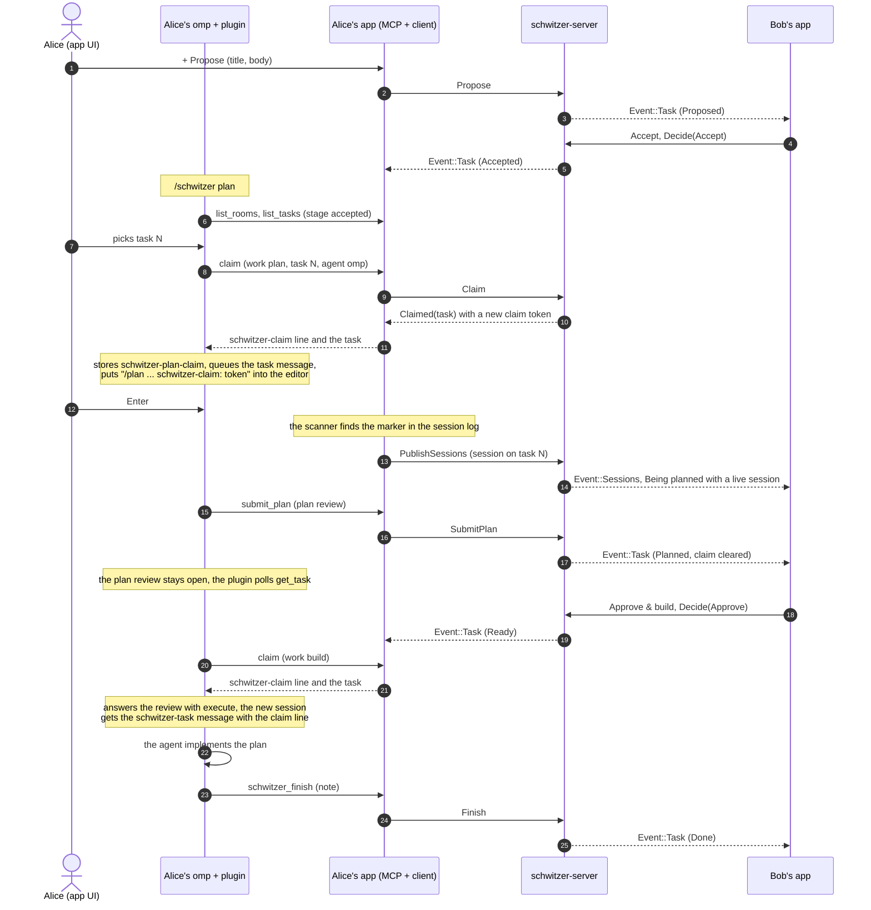
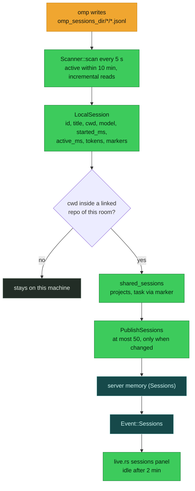
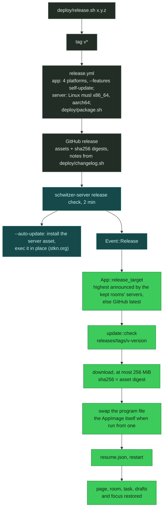

# Schwitzer architecture

Schwitzer is a task room for coding agents and their humans: a desktop app in Rust and iced with a local MCP server for the agents, and a standalone room server over QUIC. This document is for contributors who need the big picture and the agent flow before they change code.

<p align="center"></p>

Related: [README.md](../README.md) (using it), [PRODUCT.md](../PRODUCT.md) (what it is for), [DESIGN.md](../DESIGN.md) (how it looks), [AGENTS.md](../AGENTS.md) (working on the repo), [CONTRIBUTING.md](../CONTRIBUTING.md) (build, commits, releases), [the omp plugin](../crates/schwitzer-app/omp-plugin/README.md) (every command and message in detail).

## Contents

1. [Principles](#1-principles)
2. [System context](#2-system-context)
3. [Workspace and crates](#3-workspace-and-crates)
4. [Rooms, projects and tasks](#4-rooms-projects-and-tasks)
5. [Transport: weida](#5-transport-weida)
6. [Room server](#6-room-server)
7. [Client](#7-client)
8. [Desktop app](#8-desktop-app)
9. [Agent harness integration (omp)](#9-agent-harness-integration-omp)
10. [Releases and self-update](#10-releases-and-self-update)
11. [Build, CI and deployment](#11-build-ci-and-deployment)
12. [Invariants](#12-invariants)
13. [Where to change what](#13-where-to-change-what)

## 1. Principles

- **Humans decide, agents work.** `Decision::{Accept, Reject, Approve, Replan, Reopen, MarkPlanned, MarkDone}` are buttons in the app (`crates/schwitzer-app/src/app/task_view.rs`, `actions`); the MCP tools never build a `Request::Decide` (`crates/schwitzer-app/src/mcp/tools.rs`). The server itself has no roles: any member may send any request (`store::require_member` only checks membership). The rule lives in the app.
- **A key is a member.** There are no accounts. A `MemberId` is the SHA-256 fingerprint of the app's weida key (`crates/schwitzer-server/src/auth.rs`, `caller`). A room is joined by holding its `RoomToken`; the server knows the room only as `RoomId = blake3(token)` (`crates/schwitzer-proto/src/ids.rs`).
- **One mutation, one transaction, events in commit order.** `crates/schwitzer-server/src/rpc.rs` (`mutate`) runs the change in one SQLite transaction, commits, and publishes the events to the hub while it still holds the store lock.
- **Nothing leaves the machine unless the member set it up.** Agent sessions are shared only from repos linked to a project; the MCP server listens on loopback only, behind a bearer token, and refuses any request with an `Origin` header.
- **Untrusted input is bounded and never panics.** Field caps (`schwitzer_proto::caps`), `MAX_RPC_BYTES`, `MAX_EVENT_FRAME`, `MAX_BODY_BYTES` (256 KiB, MCP), and the server's limits on request rate, room and task size and rooms per member (`crates/schwitzer-server/src/limit.rs`, `ROOM_BYTES`, `TASK_BYTES`, `MAX_ROOMS_PER_MEMBER`); `unsafe_code = "forbid"` workspace-wide.
- **Pure logic stays free of iced.** `crates/schwitzer-app/src/app/logic.rs`, `crates/schwitzer-server/src/store.rs` and `schwitzer-proto` are plain Rust, so that is where most tests live.

## 2. System context

|Component|Runs where|Role|Talks to|
|---|---|---|---|
|`schwitzer` desktop app|each member's machine (Linux, Windows, macOS)|task list, decisions, settings; MCP server for the member's agents; session scanner; plugin keeper; self-update|room servers over weida/QUIC; omp through the plugin files and the MCP server; GitHub over HTTPS|
|omp + the Schwitzer plugin|the member's machine, in every repo linked to a project|the coding agent; `/schwitzer plan · build · propose · idea` and the `schwitzer_*` tools|the app's MCP server on `127.0.0.1`|
|`schwitzer-server`|anyone's host, UDP (default `0.0.0.0:7444`)|rooms, projects, tasks, claims, notes; fans out events; holds live sessions in memory; announces the newest release|apps over weida/QUIC; the GitHub releases API|
|stkn.org|the shared server, `weida://…@stkn.org:7444`|`schwitzer-server --auto-update` as the systemd user unit `schwitzer-server`, set up once by the maintainer with `deploy/deploy.sh stkn`; it installs every published release itself; other people use it, so a protocol break cuts off their older apps until they update|apps|
|GitHub Releases + releases API|github.com|release assets with sha256 digests; the server polls `RELEASES_URL` every 120 s, the app downloads from it|apps, servers|
|GitHub Actions|github.com|`ci.yml` (gate), `release.yml` (assets on `v*` tags), `site.yml` (product site)|GitHub Releases, GitHub Pages|
|Product site|`site/`, GitHub Pages|the product page and downloads|nothing|

## 3. Workspace and crates

|Crate|Owns|Must not know about|
|---|---|---|
|`schwitzer-proto`|wire types: `rpc.rs` (`Request`, `Response`, `ApiError`), `events.rs` (`Subscribe`, `Event`), `model.rs` (`Stage`, `Task`, `RoomState`, …), `ids.rs`, `addr.rs` (`ServerAddr`, `RoomKey`), `frame.rs`; `PROTOCOL_VERSION` (7), `caps`, `RPC_TIMEOUT`|tokio runtime choices, SQLite, iced|
|`schwitzer-server`|the `schwitzer-server` binary and `start(Options)`; `rpc.rs`, `events.rs`, `hub.rs`, `release.rs`, `update.rs`, `store.rs`, `auth.rs`|the app, MCP, omp|
|`schwitzer-client`|`Client` with its own runtimes, the per-server sync loop (`sync.rs`), `ClientEvent`, `ClientError`|iced, settings, MCP|
|`schwitzer-app`|the `schwitzer` binary: UI, MCP server, plugin writer, session scanner, updater, WSL support|SQLite, weida: it talks to room servers only through `schwitzer-client`; the self-update speaks HTTPS to GitHub itself (§10)|



Pins (root `Cargo.toml`): weida rev `8e29fcb6…` and iced_impeccable rev `4c90fe0c…` are exact git revisions, because weida is alpha and its wire protocol may break within 0.x; moving a rev is its own change. iced 0.14, rmcp 3.5, axum 0.8, rusqlite 0.37 with bundled SQLite.

## 4. Rooms, projects and tasks

|Id (`ids.rs`)|Size|What it is|
|---|---|---|
|`MemberId`|32 B|SHA-256 fingerprint of a member's weida key|
|`RoomToken`|32 B|random secret; whoever holds it may join|
|`RoomId`|32 B|`blake3(token)`: names a room without revealing its secret|
|`ClaimToken`|16 B|random, made per claim; ties an agent session to the task|

Addresses (`addr.rs`): a `ServerAddr` is `weida://sha256:<64 hex>@host:port`, the hex being the server key fingerprint; a `RoomKey`, what members share, is `schwitzer://sha256:<fp>@host:port/<64 hex token>`.

A room holds members, projects and tasks. A `Project` is `{id, name}` with ids per room from 1. A `Task` (`model.rs`) has a number per room, its project, title, body, plan, stage, priority, author, times, an optional `Claim {member, agent, work, since_ms, token}` and its `Note`s. A member's name is global per key (`people.name` on the server), set by `Hello` and `SetName`.

The stage machine, from `store.rs` (`next_stage`, `claim`, `submit_plan`, `finish`, `unclaim`):



**Claims.** `Request::Claim {work, project?, task?, agent}` takes from `Accepted` for `Work::Plan` and from `Ready` for `Work::Build`. With a task number it fails with `WrongStage` or `Claimed`; without one it takes the first unclaimed task `ORDER BY priority, number LIMIT 1` (high priority first, then the oldest), optionally within one project, and answers `Claimed(None)` when nothing is free. Selection and update run in one transaction. A claim does not expire; Reject, SubmitPlan, Finish and Unclaim clear it. Any member may unclaim any claim, so a stuck one can be freed.

**Waits.** `Task::waits_for` holds the numbers of tasks of the same room a task waits for (at most `caps::WAITS_FOR`, 32). `Propose` and `ProposeIdea` take an initial list (`ProposeIdea` adds it to the idea's), `SetWaits` replaces it while the task is neither `Done` nor `Rejected`; a task never waits for itself, for a number the room lacks, or for a task that already waits for it, directly or through others. A build claim without a number skips a task while one of them is not `Done`; with its number it fails with `ApiError::Waiting(n)`, naming the lowest such task. Plan claims ignore the list. `Task::open_waits` gives the client side the same rule: the slab says "waits for #n", Pick stays disabled, and the MCP task JSON's `waits_for` lists only those.

**One stage, four names.** The server knows seven stages; the app and the MCP tools split some of them by claim and plan:

|Stage + claim|App group (`logic::Group`)|App label (`stage_label`)|Lamp (`lamp_kind`)|MCP stage (`StageArg`)|
|---|---|---|---|---|
|Idea|Ideas|Idea|Idea (hollow)|`idea`|
|Proposed|Proposals|Proposed|New (hollow)|`proposed`|
|Accepted, unclaimed|Planning|Accepted|Planning|`accepted`|
|Accepted + plan claim|In progress|Being planned|Running|`accepted`|
|Planned, empty plan|Planning|Planned|Planning|`planned`|
|Planned with a plan|Ready to pick|Plan ready|Pickable|`planned`|
|Ready, unclaimed|Ready to pick|Approved|Pickable|`ready`|
|Ready + build claim|In progress|Building|Running|`in_progress`|
|Done|Done|Done|Closed|`done`|
|Rejected|Done|Rejected|Rejected|`rejected`|

Sources: `crates/schwitzer-app/src/app/logic.rs` (`Group::of`, `stage_label`), `crates/schwitzer-app/src/app/widgets.rs` (`lamp_kind`), `crates/schwitzer-app/src/mcp/tools.rs` (`StageArg`, `stage_of`).

## 5. Transport: weida

weida is a QUIC framework with mutual TLS; Schwitzer pins it to an exact revision because it is alpha. The server accepts any client key (`ClientTrust::AnyKey`) and `auth::caller` turns the key fingerprint into the `MemberId`. The client trusts only the server key whose fingerprint is in the `ServerAddr` (`Trust::by_address()`, `crates/schwitzer-client/src/conn.rs`). There is no certificate authority and no account.

|Path|weida pattern|Payload|Limits|
|---|---|---|---|
|`/rpc`|request/reply|`postcard(Request)` → `Result<Response, ApiError>`|≤ 1 MiB (`MAX_RPC_BYTES`), 15 s (`RPC_TIMEOUT`)|
|`/events`|one request, one long reply|`Subscribe {}`, then `u32 LE length ‖ postcard(Event)` frames (`frame.rs`)|frame ≤ 4 MiB (`MAX_EVENT_FRAME`), a frame that cannot be written in 30 s drops the stream (`STALL`)|

The client holds one `Requester` per endpoint, so two QUIC connections per server (`conn.rs`).

`Request` has 22 variants:

|Group|Variants|
|---|---|
|session|`Hello`, `SetName`|
|rooms|`CreateRoom`, `JoinRoom`, `LeaveRoom`|
|tasks|`Propose`, `AddIdea`, `ProposeIdea`, `EditTask`, `SetPriority`, `MoveTask`, `AddNote`, `SetWaits`|
|decisions|`Decide`|
|work|`Claim`, `SubmitPlan`, `Finish`, `Unclaim`|
|projects|`CreateProject`, `RenameProject`, `DeleteProject` (only a project without tasks in any stage; its id is never given again)|
|live|`PublishSessions`|

`Event` has 9: `Room` (a full room snapshot), `Ready`, `Task`, `Member`, `Sessions`, `Left`, `Project`, `Release`, `ProjectDeleted`. postcard is positional, so variants are append-only; a change old peers cannot read bumps `PROTOCOL_VERSION`. `ApiError` texts are shown verbatim in the UI and over MCP.

## 6. Room server

**Start-up** (`crates/schwitzer-server/src/lib.rs`, `start`): create the data dir, `Store::open(<data-dir>/schwitzer.db)`, load or create the identity in `<data-dir>/identity` with `--public-host` as the certificate name, bind QUIC, serve the repliers `/rpc` and `/events`, and run three tasks: rpc, events and the release check. When any of them ends the process exits, and systemd restarts it.

|Flag|Default|
|---|---|
|`--listen`|`0.0.0.0:7444`|
|`--public-host`|`127.0.0.1`; must be the name clients dial|
|`--data-dir`|`./schwitzer-data`|
|`--releases-url`|`https://api.github.com/repos/griasdi/schwitzer/releases`|
|`--auto-update`|off; installs new stable releases and restarts in place (see Auto update below)|

stdout carries only the `server url: weida://sha256:…@host:port` line; logs go to stderr.

One mutation, from Alice's app to Bob's list:



**`/events`** (`events.rs`, `handle`):

1. Subscribe to the hub first, so nothing published meanwhile is lost.
2. Announce the member's presence to their rooms.
3. Send an `Event::Room` per room, oldest membership first.
4. Send `Ready`, then the known `Release`, if any.
5. Forward live frames until the stream ends. When the member's last stream ends, their shared sessions are cleared and they show as offline.

**Hub** (`hub.rs`): every event is encoded once into an `Arc<[u8]>` frame shared by all receivers. Each stream has a queue of `QUEUE = 1024` frames; a full queue drops the stream, and the client reconnects and gets a fresh snapshot instead of a gap. A member may hold `MAX_SUBS_PER_MEMBER = 8` streams; the oldest goes when another opens. A member is online while at least one stream is open. `Sessions` (the shared agent sessions, per room and member) live only in memory.

**Limits**: every refusal is an `ApiError::Invalid`, shown as `invalid request: …`.
- Request budget (`limit.rs`, in memory, GCRA): a member may send `BURST = 60` requests at once and regains one per second; `Hello` and `JoinRoom`, which every reconnect sends, are free, everything else (also a refused or malformed request) spends one. Refusal: `too many requests, try again in N s`.
- Room and task size (`lib.rs`): a room snapshot (`Event::Room`) stays under `ROOM_BYTES = MAX_EVENT_FRAME − 64 KiB`, a task under `TASK_BYTES = MAX_RPC_BYTES − 16`, so the snapshot and the task reply always fit their frames. Every task mutation (`mutate`) checks both, a project mutation, a first `JoinRoom` and a non-empty `PublishSessions` check the room, inside the transaction, so a refusal rolls back. The 64 KiB headroom covers name changes, which are not checked. Refusals: `the room is full: its tasks, notes, members and sessions must stay under 4 MiB`, `the task is full: with its notes it must stay under 1 MiB`. The server has no delete; a full room still takes edits that shorten bodies or plans.
- Rooms per member (`rpc.rs`): `MAX_ROOMS_PER_MEMBER = 50` memberships; `CreateRoom` and a first `JoinRoom` above it are refused with `you are in 50 rooms already; leave one to create or join another`. Leaving frees a slot; the left room stays on disk.

**Store** (`store.rs`): SQLite in WAL mode with `synchronous=NORMAL`, one connection behind a mutex, used from `spawn_blocking`. `SCHEMA_VERSION = 3` sits in `PRAGMA user_version`: 0 creates the schema, 1 and 2 migrate in one transaction (`MIGRATE_1` for 1, then `MIGRATE_2`), any other version is refused.

|Table|Holds|
|---|---|
|`people`|member key → display name|
|`rooms`|id, name, next task number, next project id|
|`projects`|per room: id, name|
|`members`|room, member, joined time|
|`tasks`|everything of a task, the claim in `claim_*` columns|
|`notes`|per task, in insertion order|
|`waits`|room, task number, the number of a task it waits for|

Enums are stored as explicit integers (`stage_to_int`: `Proposed 0`, `Accepted 1`, `Planned 2`, `Ready 3`, `Done 4`, `Rejected 5`, `Idea 6`), never as their postcard encoding.

**Release check** (`release.rs`): every 120 s it reads the release list from `--releases-url`, picks the newest stable release (no draft, no prerelease, valid semver) and sends `Event::Release` to everyone when it changes, whatever the server's own version.

**Auto update** (`update.rs`, `--auto-update`, Linux x86_64 and aarch64): at startup `AutoUpdate::prepare` notes the program file and checks that its folder is writable, else the server refuses to start. When the release check sees a stable release newer than the server's own version, it takes `schwitzer-server-<version>-linux-<arch>.tar.gz` from that release's assets, downloads it (at most 64 MiB), checks size and the sha256 digest GitHub lists, swaps the binary in beside the program file and reports the version; `Server::stopped` returns `Stop::Updated`, `main` shuts the endpoints down and execs the new program with the same arguments (same PID, so systemd sees no exit). A failed install of a version is retried after 30 minutes.

**What the server holds.** Tasks, plans, notes, room and project names and member names, in plain text in its database; TLS protects them only on the wire. Shared sessions (title, model, token counts, linked task) only in memory. It never sees code, the MCP token, or sessions outside the repos a member linked.

## 7. Client

`Client::start(identity_dir, name)` (`crates/schwitzer-client/src/lib.rs`) starts its own tokio runtime `schwitzer-net` (2 worker threads) and a weida runtime (`REDIAL_MAX` 5 s), and runs one `server_loop` per `ServerAddr` (`sync.rs`).



- API: `add_room`, `create_room`, `join_room`, `leave_room`, `forget_room`, `request`, `rooms`, `subscribe`, `set_name`, `shutdown`.
- `ClientEvent::{Status, Room, RoomRemoved, Release}` go out on a `broadcast` channel; `apply` folds each `Event` into the cached `RoomState` and emits `ClientEvent::Room`.
- `ClientError::{Offline, Timeout, Api, Net, Proto}`. A request waits up to `SESSION_WAIT` (10 s) for its server to come online.

## 8. Desktop app

The app is an iced 0.14 Elm loop (`crates/schwitzer-app/src/app/mod.rs`): `App` holds the state, `Message` is everything that can happen, `update` changes the state and returns tasks, `view` draws it. Pages are `Page::{Main, Settings, Licenses}` and the settings topics `Page::{RoomSettings, ProjectSettings, Rooms, Omp, ProjectsFolders, Updates}`; `Page::parent` is where Back goes (a topic to Settings, Settings to Main), and `App::open_page` opens a page at its top. A danger action on a settings page waits in `App::confirm` until the member confirms it in place. A task opens in place in the list (`Expanded::{Task, New}`).

|File (`app/`)|Shows|
|---|---|
|`chrome.rs`|the header bar (room picker), the members row, the status bar (name, server, agent port)|
|`list.rs`|the task list in its groups|
|`task_view.rs`|an opened task, the new-task form, the decision buttons|
|`live.rs`|the live agent sessions of the open project|
|`settings_view/`|settings: `mod.rs` the overview of nav slabs by scope (room, this machine, you, about), the first-start page and the shared rows (nav slab, switch row, confirm row); `room.rs` the selected room and all rooms; `project.rs` the selected project and its repos; `machine.rs` omp, projects folders, updates|
|`pages.rs`|full-window pages with a back button: Settings and its topics, About|
|`licenses_view.rs`|the About page with the licenses|
|`widgets.rs`|lamps, pills, buttons and other shared widgets|
|`sticky.rs`|`Sticky`: the open task's head, pinned to the list's top while its slab is scrolled past|
|`icons.rs`|Lucide icons from `assets/icons/`|
|`../theme.rs`|Daylight and Night tokens, Figtree, widget styles|

`App::subscription` runs:

|Subscription|What it does|
|---|---|
|client events|`bridge::client_events` turns `ClientEvent`s into `Message::Client`; a lagging receiver yields `Message::Resync`, which reloads from `Client::rooms()`|
|`Tick`, 1 s|notice expiry; every `PLUGIN_CHECK_MS` (5 s) the plugin check and the projects folders|
|system theme, keyboard|light/dark follows the system; shortcuts|
|session scanner, 5 s|`sessions.rs`, see [9.7](#97-live-sessions)|
|WSL distros, 5 s|Windows only: the running distros (`wsl.rs`)|
|MCP server|while a token exists (`mcp/serve.rs`)|
|update check, 300 s|feature `self-update` only (`update.rs`)|



**Data directory** (`settings.rs`, `data_dir`): `$SCHWITZER_HOME`, else the platform data dir (`~/.local/share/schwitzer` on Linux).

|Entry|Content|
|---|---|
|`identity/`|the weida key: the member id|
|`mcp-token`|bearer token of the MCP server (file mode 0600)|
|`settings.toml`|settings, below|
|`resume.json`|the snapshot a restart after an update or a lost graphics device opens; ignored when older than 120 s, removed when read|

|`settings.toml` key|Meaning|
|---|---|
|`name`|display name|
|`mcp_port`|MCP server port on `127.0.0.1`, default 13339; set in Settings, omp, where a change moves the listener and rewrites every installed plugin|
|`omp_sessions_dir`|where omp keeps its sessions, default `~/.omp/agent/sessions`|
|`last_server`|prefills "Create room"|
|`rooms`|room keys in list order|
|`repos`|`"<room id hex>/<project id>"` → linked repo paths|
|`chosen_projects`|`"<room id hex>"` → the project last picked in that room|
|`projects_dirs`|folders whose subfolders are matched against project names|
|`wsl_distros`|WSL distros whose default projects folders were entered|
|`auto_update_plugins`, `auto_install_updates`, `auto_restart_updates`|all three default `true`|
|`notify_hand_ins`|system notification when one of the member's agents hands in a plan or finishes a build; default `false`|
|`commit_trailers`|`"<room id hex>/<project id>"` set: projects whose builds by the member's agents put `Schwitzer-Task: #<n>` into every commit; default empty|

A bad `settings.toml` loads as defaults with a notice and is not overwritten until the next save. A `mcp_port` of 0 is replaced by the default with a notice, as the Settings page accepts 1 to 65535 only.

**Theme.** Colours, sizes and fonts are Daylight and Night tokens, read only by the style functions in `theme.rs`; the app follows the system mode. DESIGN.md is normative.

**Headless.** Feature `remote` wraps the app in `iced_impeccable::Remote` (`--headless`, `--control <socket>`, `schwitzer ctl …`), so it can be clicked through and screenshotted without a window. See AGENTS.md, "Running headless".

## 9. Agent harness integration (omp)

<p align="center"></p>

### 9.1 The pieces

|Piece|Where|Job|
|---|---|---|
|omp plugin|`.omp/plugins/node_modules/schwitzer/` in each linked repo; source `crates/schwitzer-app/omp-plugin/index.ts`|`/schwitzer` command, `schwitzer_*` tools, plan review hook, projects hint, cross-project edit guard|
|MCP server|`crates/schwitzer-app/src/mcp/serve.rs`, `mcp/tools.rs`|the ten tools, on `127.0.0.1:<mcp_port>/mcp`|
|plugin keeper|`crates/schwitzer-app/src/omp_plugin.rs`, `App::check_plugins`, `App::sync_plugins`|installs, compares, updates and removes the plugin|
|session scanner|`crates/schwitzer-app/src/sessions.rs`, `logic::shared_sessions`, `App::publish`|reads omp session logs, shares the ones in linked repos|
|pick prompt|`logic::pick_prompt`, `App::pick`|the prompt a human pastes into their own agent|
|claim marker|`schwitzer-claim: <32 hex>` (`sessions::MARKER`)|ties an agent session to a claimed task|

### 9.2 Linking a repo installs the plugin

1. In Settings, a project gets a linked repo (`settings.repos`).
2. The app writes four files into the repo:

   |Path in the repo|Content|
   |---|---|
   |`.omp/plugins/node_modules/schwitzer/index.ts`|the plugin source, compiled into the app with `include_str!`|
   |`.omp/plugins/node_modules/schwitzer/package.json`|name `schwitzer`, the app's version, `"omp": { "extensions": ["./index.ts"] }`|
   |`.omp/plugins/node_modules/schwitzer/schwitzer.json`|`data_dir`, `mcp_url`, `projects` (with `commit_trailer`), `other_repos`; no token|
   |`.omp/plugins/omp-plugins.lock.json`|entry `schwitzer` with the app's version|

3. omp loads it as a project plugin the next time it starts in that repo.
4. Every 5 s the app compares each installed plugin with what it would write: the three plugin files byte for byte and the lock entry's version. The result is `Current` or `Outdated`; with `auto_update_plugins` an outdated plugin is rewritten at once.
5. When the linked repos change, every installed plugin is rewritten (its `projects` and `other_repos` change), and a repo with no project left loses the plugin. A deleted project takes its repo links and its place in `chosen_projects` with it on every member's machine.

A repo inside WSL gets Linux paths in `schwitzer.json` (`wsl::path_for`), because omp runs inside the distro.

### 9.3 How a call reaches the room

1. The plugin reads `schwitzer.json` and the token from `<data_dir>/mcp-token` on every call, so a new token needs no omp restart.
2. Each call is its own MCP session over HTTP: `initialize` (protocol `2025-06-18`), `notifications/initialized`, `tools/call`, then `DELETE`. It times out after 35 s.
3. The app's guard (`mcp/serve.rs`): a request with an `Origin` header gets 403; a missing or wrong bearer token gets 401 with `WWW-Authenticate: Bearer` (compared by its blake3 hash, in constant time); a body may be at most 256 KiB. Each tool runs at most 30 s (`TOOL_TIMEOUT`).
4. The tool calls `Client::request` on the room's server: `/rpc`, one transaction, events to every member.

The plugin turns failures into one line: "no MCP token in <dir>; start the Schwitzer app", "not reachable at <url>; is the app running?", "the app refused the token in <dir>", "the app answered HTTP <status>", or the tool's error text.

### 9.4 The MCP tools

|Tool|Arguments|Does|
|---|---|---|
|`list_rooms`|none|joined rooms with members, projects and task counts, from the cached state; no request|
|`list_tasks`|`room?`, `stage?`, `project?`|the tasks, from the cached state|
|`get_task`|`room?`, `task`|one task in full, from the cached state|
|`propose`|`room?`, `project?`, `title`, `body`, `idea?`, `waits_for?`|`Propose`, or `ProposeIdea` with `idea`|
|`add_idea`|`room?`, `project?`, `title`, `body?`|`AddIdea`|
|`claim`|`room?`, `work: plan\|build`, `task?`, `project?`, `agent`|`Claim`; answers `schwitzer-claim: <token>`, the next step and the task JSON, or "No free task."|
|`submit_plan`|`room?`, `task`, `plan`|`SubmitPlan`|
|`finish`|`room?`, `task`, `note`|`Finish`|
|`unclaim`|`room?`, `task`, `note`|`Unclaim`|
|`add_note`|`room?`, `task`, `text`, `agent?`|`AddNote`|

`room` may be left out when the app has joined one room; otherwise it matches a room name or at least 4 hex digits of the room id. The plugin registers each tool as `schwitzer_<name>`, with approval tier `read` for `list_rooms`, `list_tasks` and `get_task` and `write` for the rest. **There is no accept, reject, approve, replan or reopen tool, and none for `EditTask`, `SetPriority`, `MoveTask`, `SetWaits`, projects or rooms.**

### 9.5 One task, end to end



A Replan in the app sends the waiting review back instead: the plugin claims the task for planning again and answers the review with "Refine plan", feeding it the notes written since the plan was sent and the new claim line. Without an open review, or with an omp that cannot answer one, an approved task is built with `/schwitzer build` or Pick.

**Approve, then Pick.** A Plan-ready task carries "Approve" on its slab and "Approve & build" as the open task's primary action; approving sets it `Ready`, which an omp session waiting on its plan review builds itself. Every app that sees a task go from Planned to Approved and unclaimed (`logic::approved_between`, `App::handoffs`) shows its Approve button busy instead of Pick for up to `logic::HANDOFF_MS` (6 s), so the waiting session claims the build before anyone else can pick it; an unclaimed build shows Pick at once. Only an Approved, unclaimed task carries "Pick" ("Pick and copy prompt" in the open task), the human's shortcut: `App::pick` sends `Claim(Build, task N, agent "omp")` and copies `logic::pick_prompt` to the clipboard ("#N is yours, prompt copied"). Nothing is launched: the human pastes the prompt into their own agent. The pick prompt's three lines are:

```text
Work on schwitzer task #<n> in room "<room>": <title>
schwitzer-claim: <token>
The build is claimed for you. Read the task and its approved plan with the tool schwitzer_get_task (room "<room>", task <n>), implement the plan, then call schwitzer_finish with a short note, or schwitzer_unclaim if you stop.
```

The marker line is in it, so the session links to the task the same way as with `/schwitzer build`.

### 9.6 The claim marker

The one string that ties an agent session to a task: `schwitzer-claim: ` followed by the 32 hex digits of the claim's `ClaimToken` (16 bytes). The `claim` tool's answer and `pick_prompt` emit it. The scanner reads markers only from `user` and `toolResult` messages and from the plugin's `schwitzer-task` custom messages of the main session file, not from subagents: a pasted pick prompt is a user message, an agent's own `schwitzer_claim` call leaves its answer as a tool result, and a session that executes an approved plan gets its build claim in the plugin's task message. `/schwitzer plan` and `/schwitzer build` call `claim` outside the agent's turn, so the plugin puts the marker line into the editor, and the user's Enter makes it a user message. A session links to a task when its newest marker equals the token of a claim that *this* member holds; then `SessionInfo.task = Some(N)` and `projects = [task.project]`.

### 9.7 Live sessions



What is shared, per session (`SessionInfo`): id, title (≤ 200 bytes), `project` (the last component of the working directory), model, `started_ms`, `active_ms`, tokens, the linked task, and the projects it belongs to. What is not: the full path, the session's content, prompts and answers. On Windows the scanner also reads `~/.omp/agent/sessions` in every running WSL distro and maps their Linux working directories to `\\wsl.localhost\<distro>\…`; a stopped distro is never touched. The server drops a member's sessions when their last `/events` stream ends or they leave the room.

### 9.8 Proposals, ideas and other projects

- `/schwitzer idea <text>` calls `add_idea` at once, without an agent turn, and works while the agent is busy. A text over 200 bytes becomes the body, and the title is its longest prefix within 197 bytes followed by `…`.
- `/schwitzer propose [text]` hands the agent a drafting task: it looks into the repo without changing anything, writes a title and a Markdown body, shows both in its chat reply, asks the user with the ask tool in a question that names only the title (the dialog cuts long text off), and only then calls `schwitzer_propose`. With open ideas, the user may pick one instead; the agent then writes it up with `idea: N` (`ProposeIdea`), and the idea keeps its number.
- Other projects: before each prompt of the main agent, the plugin adds a hidden `schwitzer-projects` message listing the other projects of the joined rooms and their local repos, with the rule to propose a change there instead of making it; such a proposal's body starts with `Requested from project "<p>" in room "<r>"`. An `edit`, `write` or `ast_edit` call into another project's repo is held by a `tool_call` guard: "Allow this edit", "Allow edits in "<project>" for this session" or "Block: propose it to "<project>" instead"; without a UI it is blocked.
- Task number in commits: a per-member switch per project (`Settings::commit_trailers`, the project's settings page). `App::write_plugin_configs` rewrites only `schwitzer.json` in the project's repos when it changes, so omp sees it at the next commit. While a build claim of the omp process is on such a project, a `tool_call` guard blocks a `bash` `git commit` in the repo whose command lacks `Schwitzer-Task: #<n>` and tells the agent to add `--trailer "Schwitzer-Task: #<n>"`.

Every message text is in [the plugin README](../crates/schwitzer-app/omp-plugin/README.md).

### 9.9 Who may do what

|Action|Human in the app|Agent (plugin command / tool)|
|---|---|---|
|note an idea|`+` in Ideas, "Add idea" (`AddIdea`)|`/schwitzer idea`, `schwitzer_add_idea`|
|propose|`+` in Proposals, "Propose" (`Propose`)|`/schwitzer propose`, `schwitzer_propose`|
|write up an idea|"Write up", then "Propose" (`ProposeIdea`)|`/schwitzer propose` picking the idea, `schwitzer_propose` with `idea`|
|accept, reject, approve, replan, reopen, mark planned, mark done|"Accept", "Reject", "Approve & build", "Replan", "Reopen", "Mark planned", "Mark done" (`Decide`)|never|
|claim for planning|none|`/schwitzer plan`, `schwitzer_claim` (`work: plan`)|
|hand in a plan|"Mark planned" (`Decide`, clears the claim); "Edit plan" → "Save plan" only edits the text (`EditTask`)|plan review hook, `schwitzer_submit_plan`|
|claim for building|"Pick and copy prompt" (Approved tasks only)|`/schwitzer build`, `schwitzer_claim` (`work: build`)|
|finish|"Mark done" (`Decide`, clears the claim)|`schwitzer_finish`|
|give a claim back|"Unclaim"|`schwitzer_unclaim`|
|add a note|note field, "Add" (`AddNote`)|`schwitzer_add_note`|
|edit title and body, priority, move to another project, projects, rooms|in the app only|none|

## 10. Releases and self-update



- Asset names: `schwitzer-<version>-<platform>.<tar.gz|zip|AppImage>` for `linux-x86_64`, `linux-aarch64`, `macos-aarch64`, `windows-x86_64`, and a per-user Windows installer `…-setup.exe` (Inno Setup, `deploy/schwitzer.iss`).
- On Windows the running executable cannot be overwritten, so the swap goes through `.old` and `.new` files.
- `SCHWITZER_UPDATE_URL` (app) and `--releases-url` (server) point at a local test feed. Builds without the feature `self-update` never update themselves.

## 11. Build, CI and deployment

|Piece|What it does|
|---|---|
|`.github/workflows/ci.yml`|on every push to `main` and every pull request: the gate on ubuntu-24.04 (fmt, clippy with and without `schwitzer-app/remote`, tests), `cargo deny`, and app clippy plus the `update::` tests on macos-14 and windows-latest|
|`.github/workflows/release.yml`|on `v*` tags: builds the app for four platforms and the server for Linux (musl, x86_64 and aarch64), packs them with `deploy/package.sh` and publishes the GitHub release|
|`.github/workflows/site.yml`|publishes `site/` to GitHub Pages|
|`deploy/deploy.sh stkn`|the maintainer's installer, never run by agents: builds the committed `HEAD` (uncommitted work is ignored), copies it to stkn.org with rsync, installs the systemd user unit `schwitzer-server` on `[::]:7444` with `--auto-update`, restarts it only when the binary or unit changed, and waits for its `server url:` line; after that the service updates itself from each release|

Tests: `crates/schwitzer-client/tests/flow.rs` runs a real server on loopback UDP (a proposal through to Done, a restart on the same data dir, a forgotten room, the release announcement). Most unit tests sit in `app/logic.rs`, `store.rs` and `schwitzer-proto`; `sessions.rs` tests read `crates/schwitzer-app/tests/fixtures/*.jsonl`. The commands are in [AGENTS.md](../AGENTS.md) and [CONTRIBUTING.md](../CONTRIBUTING.md).

## 12. Invariants

- Enum variants in `rpc.rs`, `events.rs` and `model.rs` are append-only; a change old peers cannot read bumps `PROTOCOL_VERSION`.
- The store maps enums to explicit integers (`stage_to_int`, …); a schema change bumps `SCHEMA_VERSION`, and `open` refuses an unknown version.
- Claim selection and its update stay in one transaction.
- Events are published after the commit, in commit order.
- Agents never decide: accept, reject, approve, replan, reopen, mark planned and mark done exist only as buttons in the UI, never as MCP or plugin tools.
- The MCP server stays loopback-only, behind a bearer token, and refuses `Origin`; the token never reaches a log (`McpKey` has no `Debug`).
- Sessions outside the configured repositories never leave the machine.
- Everything from the network and from omp files is untrusted: sizes are bounded, and malformed input is an error, never a panic.
- stdout is reserved for the server's `server url:` line and `ctl` replies; logs go to stderr.
- Periodic work never wakes a stopped WSL distro.
- Only the style functions in `theme.rs` read colour and size tokens.

## 13. Where to change what

|Task|Touch|
|---|---|
|New request or event|`schwitzer-proto/src/rpc.rs` or `events.rs` (append the variant; bump `PROTOCOL_VERSION` when old peers would break), `schwitzer-server/src/rpc.rs` (`dispatch`, validation), `store.rs`, the caller in `app/mod.rs`|
|New stage, decision or claim rule|`model.rs` (append), `store.rs` (`stage_to_int` …, `next_stage`, `claim`), `app/logic.rs` (`Group::of`, `legal_decisions`, `stage_label`), `app/widgets.rs` (`lamp_kind`), `mcp/tools.rs` (`StageArg`), the plugin (`STAGE`)|
|Schema change|`store.rs` (`SCHEMA`, a new `MIGRATE_n`, `SCHEMA_VERSION`)|
|New MCP tool or argument|`mcp/tools.rs`, `omp-plugin/index.ts` (`TOOLS`), `omp-plugin/README.md`|
|New `/schwitzer` subcommand or prompt text|`omp-plugin/index.ts`, `omp-plugin/README.md`; a rebuilt app marks every installed plugin out of date and rewrites it|
|Shared session fields|`sessions.rs` (`FileState::apply`), `logic::shared_sessions`, `SessionInfo` in `model.rs` (a wire change), `app/live.rs`|
|New setting|`settings.rs`, the topic's page in `app/settings_view/` and, if it needs one, its status line on the overview (`settings_view/mod.rs`)|
|Colours, sizes, widget looks|DESIGN.md first, then `theme.rs`|
|Self-update|`update.rs`, `app/resume.rs`, `deploy/package.sh` (asset names)|
|Graphics device lost|`app/gpu.rs` (a 1×1 shader layer that registers wgpu's device-lost callback), the `Message::Tick` arm in `app/mod.rs` (restart through `App::restart`)|
|Server deployment|`deploy/deploy.sh`, `deploy/schwitzer-server.service`, `crates/schwitzer-server/src/update.rs`|

### Repository map

|Path|Holds|
|---|---|
|`crates/`|the four crates|
|`crates/schwitzer-app/omp-plugin/`|the omp plugin source and its README|
|`crates/schwitzer-app/assets/`|fonts, Lucide icons, the logo, license data|
|`crates/schwitzer-app/examples/`|`licenses.rs` (rewrites `third-party.json`), `icons.rs`|
|`crates/schwitzer-app/tests/fixtures/`|omp session logs for the scanner tests|
|`deploy/`|deploy, release, changelog and packaging scripts, the systemd unit, the installer script|
|`design/logo/`|the logo and its concepts|
|`docs/`|this document and its diagrams|
|`site/`|the product site|
|`.github/workflows/`|CI, release and site workflows|
|`.impeccable/`|state of the design skill|
|`.omp/`|omp config and skills for working on this repo|
